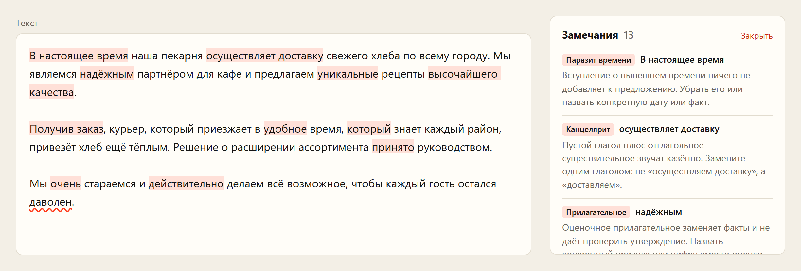
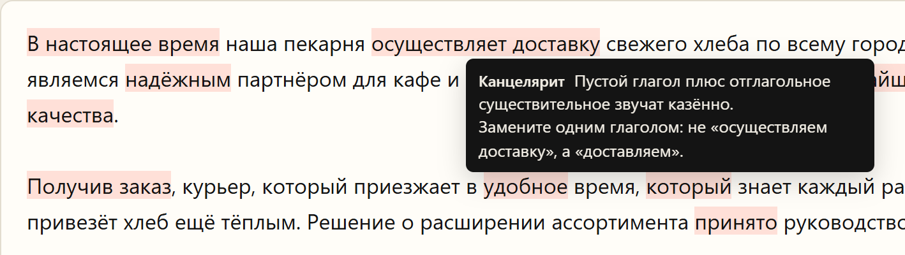
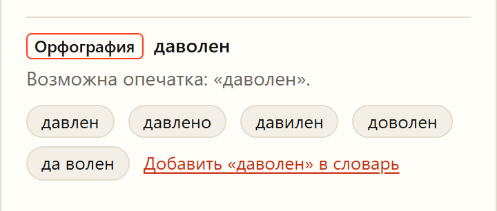
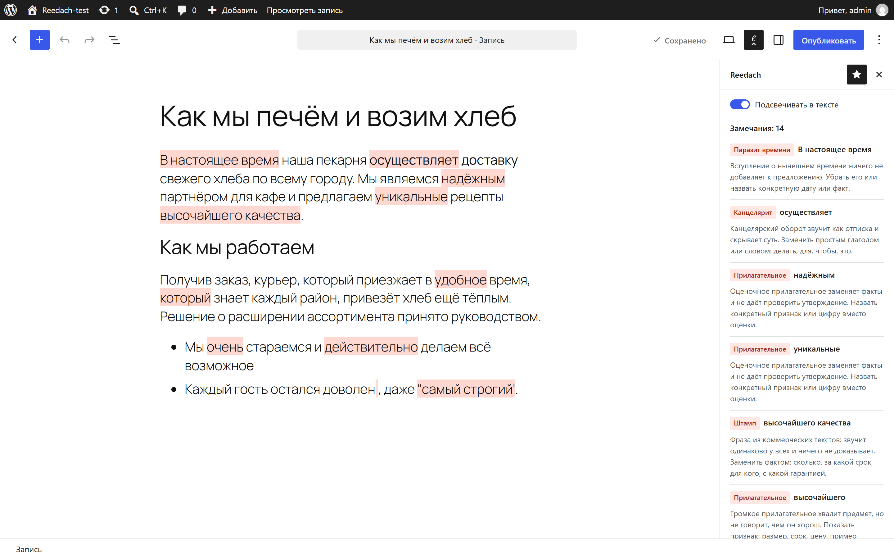

<h1>
  <picture>
    <source media="(prefers-color-scheme: dark)" srcset="docs/logo/reedach-logo-dark.svg">
    
  </picture>
</h1>

[](https://www.npmjs.com/package/reedach)
[](https://github.com/dimafaller-en/reedach/actions/workflows/test.yml)
[](LICENSE)

Проверка русского текста для сайтов и редакторов. Находит канцелярит, штампы, воду,
оценочные слова, тяжёлый синтаксис и опечатки, объясняет, что не так, и предлагает, как
сказать проще. Подсказки появляются прямо в поле ввода, пока автор пишет.

Reedach работает у вас: в браузере или на вашем сервере. Текст никуда не уходит.
Сайт проекта — [dimafaller.ru/reedach](https://dimafaller.ru/reedach/). Что нового — в [истории версий](CHANGELOG.md).

<picture>
  <source media="(prefers-color-scheme: dark)" srcset="docs/screenshots/demo-dark.png">
  
</picture>

## Что находит

| Что | Пример | Подсказка |
|---|---|---|
| Канцелярит | осуществляет доставку | «доставляет» |
| Штампы | высочайшего качества | заменить фактом: сколько, за какой срок, с какой гарантией |
| Оценки и усилители | надёжный, уникальный, очень, действительно | назвать признак или цифру |
| Паразиты времени | в настоящее время | убрать или назвать дату |
| Тяжёлый синтаксис | два «который» подряд, страдательный залог, длинные предложения и абзацы | разбить, начать с того, кто действует |
| Заимствования и жаргон | дедлайн, фидбек, юзать | русское слово: срок, отзыв, использовать |
| Плеоназмы | памятный сувенир, в конечном итоге | оставить нужное слово |
| Паронимы | одел пальто, предвыборная компания | надел, кампания |
| Частые ошибки | вообщем, по приезду, согласно договора, оплатить за | правильное написание в подсказке |
| Просторечия | ихний, ложит, щас | литературная форма |
| Типографика | прямые кавычки, дефис вместо тире и в диапазонах «10:00-18:00», лишние пробелы, непарные скобки, «!!!», «м2», «25-ый», латинская буква в русском слове | ёлочки, тире, один пробел |
| Опечатки | даволен | варианты исправления одним нажатием |

У многих подсказок есть готовый вариант замены: нажмите на него, и слово заменится в тексте.
Сам текст без нажатия не меняется.

Для опечаток, морфологии и подбора формы слова в замене нужен сервер Reedach, остальное работает
и в браузере.

<table>
  <tr>
    <td width="62%">
      <picture>
        <source media="(prefers-color-scheme: dark)" srcset="docs/screenshots/tooltip-dark.png">
        
      </picture>
    </td>
    <td width="38%">
      <picture>
        <source media="(prefers-color-scheme: dark)" srcset="docs/screenshots/spelling-dark.png">
        
      </picture>
    </td>
  </tr>
  <tr>
    <td>Объяснение — при наведении на слово</td>
    <td>Варианты для опечатки и свой словарь</td>
  </tr>
</table>

## Как подключить

| Способ | Что проверяет | Подробности |
|---|---|---|
| [Виджет на странице](#виджет-на-любую-страницу) | стиль; с сервером — ещё орфографию и морфологию | [packages/widget](packages/widget/README.md) |
| [Сервер в Docker](#сервер-с-орфографией) | всё: орфографию, морфологию и стиль по HTTP API | [packages/server](packages/server/README.md) |
| [Библиотека в коде](#библиотекой-в-коде) | стиль в браузере и Node; всё — в Node с hunspell | [packages/core](packages/core/README.md) |
| [Плагин для WordPress](#плагин-для-wordpress) | стиль в редакторе блоков, без сервера | [packages/wordpress](packages/wordpress/README.md) |

### Виджет на любую страницу

Подсветка ложится поверх текста в `textarea`, список замечаний обновляется, пока автор пишет.
Нажатие на вариант заменяет слово в поле, Ctrl+Z отменяет замену. «Добавить в словарь»
запоминает слово в браузере автора, а сайт может подключить своё хранилище. Интерфейс на
русском и английском.

```html
<script src="https://cdn.jsdelivr.net/npm/reedach-widget@0.3.2/dist/reedach.min.js"
        integrity="sha384-+b0TQ8Vfz4ZeaWhABr7Pv49jCYTZoajS8qaSb4Ty/3PEoOCLY7QiECW5epXAnrxA"
        crossorigin="anonymous" defer></script>

<textarea data-reedach
  data-reedach-endpoint="https://checker.example.ru/v1"
  data-reedach-key="ключ-сайта"
  data-reedach-format="markdown"
  data-reedach-panel="#hints"></textarea>
<div id="hints"></div>
```

`integrity` проверяет, что CDN отдал именно этот файл: если его подменят, браузер скрипт не запустит.
Хеш свой у каждой версии, берите его из README той версии, которую подключаете.

Все атрибуты, кроме `data-reedach`, необязательны. Без `data-reedach-endpoint` проверка идёт
только в браузере. Без `data-reedach-panel` список появится сразу под полем.

Ключ в коде страницы виден любому посетителю. Привяжите его на сервере к адресу своего сайта
или отправляйте запросы через сервер сайта: тогда укажите в `data-reedach-endpoint` адрес своего
посредника, а ключ не указывайте.

Из кода — то же самое с настройками:

```js
import {attach} from 'reedach-widget';

const checker = attach(document.querySelector('textarea'), {
  endpoint: '/api/reedach',      // сервер Reedach или посредник с тем же API; без него — только стиль
  format: 'markdown',            // 'text' (по умолчанию) или 'markdown'
  panel: document.querySelector('#hints'),
  disable: ['intensifiers'],     // выключить правила по id или целые категории
  dictionary: {                  // своё хранилище слов автора; по умолчанию — localStorage
    list: async () => ['Reedach'],
    add: async word => { /* сохранить у себя */ },
  },
  request: null,                 // своя функция запросов: для входа по cookie, CSRF-токена и т. п.
});
```

Виджет не приносит своих цветов и шрифтов, оформление задаёт сайт:

```css
::highlight(reedach-word)  { background-color: rgba(255, 61, 31, .15); }  /* слова и обороты */
::highlight(reedach-long)  { background-color: rgba(20, 20, 20, .06); }   /* длинные предложения и абзацы */
::highlight(reedach-spell) { text-decoration: underline wavy #ff3d1f; }   /* опечатки */
::highlight(reedach-active){ background-color: #ffc4b5; }                 /* место, куда перешли из списка */
```

Список и подсказка собраны из элементов с классами `reedach-*`. Готовый пример стилей для
светлой и тёмной темы — в [demo.css](packages/widget/demo/demo.css), начиная со строки `/* Widget */`.

Подсветка работает в Chrome и Edge 105+, Safari 17.2+, Firefox 140+. В старых браузерах будет
только список замечаний. Все настройки и методы — в [README виджета](packages/widget/README.md).

### Сервер с орфографией

```bash
docker run -d -p 3000:3000 -e REEDACH_KEYS="длинный-ключ-сайта=https://ваш-сайт.ru; ключ-для-сервера-сайта" ghcr.io/dimafaller-en/reedach
```

Образ собран для amd64 и arm64, весит 139 МБ, hunspell и словари уже внутри. Тексты не
сохраняются и не пишутся в журнал.

**Ключи.** Ключ — это пароль от вашего сервера Reedach. Его никто не выдаёт, регистрироваться
нигде не нужно: вы придумываете ключ сами, передаёте его серверу при запуске и сообщаете своему
сайту. Без правильного ключа сервер текст не проверяет, поэтому чужие сайты и скрипты вашим
сервером не воспользуются.

1. Сделайте два случайных ключа длиной от 16 символов, например `openssl rand -hex 24`.
2. Передайте оба серверу в `REEDACH_KEYS` через `;`. К первому через `=` допишите адрес своего
   сайта, он будет для браузера. Второй оставьте без адреса, он для сервера сайта:
   `REEDACH_KEYS="9f2c51d0e8a4b7c3f61e71a2=https://ваш-сайт.ru; 4b8de0a93c17f6b25d0c3f88"`.
3. Ключ с адресом укажите виджету в `data-reedach-key`. Он будет виден в коде страницы, и это
   нормально: из браузера сервер примет его только со страниц `ваш-сайт.ru`.
4. Ключ без адреса держите в секрете на сервере сайта и передавайте в заголовке
   `Authorization: Bearer <ключ>`. С ним сервер не пустит запрос из браузера.

Для нескольких сайтов заведите по ключу на каждый, у одного ключа может быть несколько адресов
через запятую. Чтобы сменить ключ, перезапустите сервер с новым списком.

Чужой сайт ключ со своих страниц использовать не сможет, но скрипт вне браузера сможет, а сдержат
его только лимиты. Надёжнее отправлять запросы через сервер своего сайта и не открывать Reedach
в интернет.

**Запросы.** Ключ передаётся в заголовке `Authorization: Bearer <ключ>`, тело — JSON.

```bash
curl https://checker.example.ru/v1/check \
  -H 'Authorization: Bearer ключ-для-сервера-сайта' -H 'Content-Type: application/json' \
  -d '{"text": "В настоящее время мы осуществляем доставку.", "ignore": ["Reedach"]}'
```

```json
{"issues": [
  {"start": 0, "end": 17, "id": "time-parasite-start", "category": "time", "label": "Паразит времени",
   "message": "Вступление о нынешнем времени ничего не добавляет к предложению.", "fix": "…"},
  {"start": 21, "end": 42, "id": "weak-verb-noun", "category": "bureaucratese", "label": "Канцелярит",
   "message": "Пустой глагол плюс отглагольное существительное звучат казённо.",
   "fix": "Замените одним глаголом: не «осуществляем доставку», а «доставляем»."}
]}
```

| Запрос | Что делает |
|---|---|
| `POST /v1/check` | проверить `markdown`, `text` или `blocks`; `ignore` — слова автора, `disable` — выключенные правила, `checks` — какие проверки запускать: `spelling`, `morph`, `style` |
| `POST /v1/suggest` | варианты исправления: `{"words": ["превет"]}`, до 20 слов за раз |
| `GET /v1/rules` | все правила с категориями и объяснениями — для страницы настроек |
| `GET /health` | сервер работает; ключ не нужен |

Ошибки: 401 — нет ключа, 403 — ключ не для этого сайта, 413 — слишком большой текст,
422 — неверные поля, 503 — сервер занят, повторить через `Retry-After` секунд.

**Настройки.**

| Переменная | По умолчанию | Что задаёт |
|---|---|---|
| `REEDACH_KEYS` | — (обязательно) | ключи доступа |
| `PORT` | `3000` | порт |
| `HOST` | `0.0.0.0` | адрес |
| `REEDACH_MAX_BYTES` | `200000` | максимальный размер запроса в байтах (200 КБ — около 100 тысяч знаков русского текста) |
| `REEDACH_CONCURRENCY` | `2` | сколько проверок идёт одновременно |
| `REEDACH_QUEUE` | `20` | сколько запросов может ждать; остальные получат 503 |
| `REEDACH_TIMEOUT` | `20000` | сколько миллисекунд может идти одна проверка; дольше — 503 |
| `REEDACH_DEMO` | — | `1` — страница-пример по адресу `/demo/`, как на скриншотах |

Полное описание полей и ответов — в [README сервера](packages/server/README.md).

### Библиотекой в коде

Только стиль, без зависимостей, в браузере и Node:

```bash
npm i reedach
```

```js
import {checkStyle, sourceBlocks, mergeIssues} from 'reedach';

const markdown = 'В настоящее время мы осуществляем доставку хлеба.';
const blocks = sourceBlocks(markdown);              // абзацы, пункты списков, заголовки
const issues = mergeIssues(blocks, {local: checkStyle(blocks)});

for (const it of issues)
  console.log(markdown.slice(it.start, it.end), '—', it.label, '—', it.message, it.fix);
```

`start` и `end` указывают на место в исходном тексте, поэтому замечание можно подсветить
прямо в поле ввода. Блоки можно передать и без Markdown: `checkStyle([{text: '…', kind: 'p'}])`,
где `kind` — `p` (абзац), `li` (пункт списка) или `h` (заголовок). Длину предложения и абзаца
можно настроить: `checkStyle(blocks, {maxSentenceWords: 25, maxParagraphWords: 120})`.

Всё вместе — орфография, морфология и стиль — в Node, без отдельного сервиса. Нужен установленный hunspell:

```bash
npm i reedach-server
```

```js
import {check} from 'reedach-server';

const {issues} = await check({
  markdown: 'В настоящее время мы осуществляем доставку.',
  ignore: ['Reedach'],            // слова автора: формы тоже принимаются
  disable: ['intensifiers'],      // выключить правило по id или целую категорию
});
```

### Плагин для WordPress

Подсказки по стилю прямо в редакторе блоков. Проверка идёт в браузере автора, сервер не нужен,
поэтому плагин работает на любом хостинге. Орфографии в плагине нет: для неё нужен сервер.



- Панель Reedach в редакторе: список замечаний, нажатие выделяет фрагмент в тексте.
- Подсветка в заголовке записи, абзацах, подзаголовках, списках, цитатах и подписях.
- «Настройки → Reedach»: какие виды подсказок показывать авторам.

Скачайте `reedach-wordpress-X.Y.Z.zip` из [последнего релиза](https://github.com/dimafaller-en/reedach/releases/latest)
и загрузите в «Плагины → Добавить новый → Загрузить плагин». Нужны WordPress 6.5+ и PHP 7.4+.
Плагин под лицензией GPL-2.0-or-later, подробнее — в [packages/wordpress](packages/wordpress/README.md).

## Орфография: hunspell

Опечатки ищет [hunspell](https://github.com/hunspell/hunspell) — открытая программа проверки
орфографии, на которой работает проверка в LibreOffice и Firefox. Reedach не встраивает её в свой код, а
запускает отдельной программой на вашем сервере, поэтому текст не уходит в чужие сервисы.

**Словари.** Русский — [dictionary-ru](https://github.com/wooorm/dictionaries) на основе словаря
Александра Лебедева, английский — dictionary-en на основе SCOWL. Оба подключены сразу, поэтому
английские слова в русском тексте не считаются ошибками. Русскому словарю много лет: новых слов
и заимствований в нём может не быть. Для них есть слова автора.

**Что проверяется.** Слова из букв, в том числе через дефис. Пропускаются ссылки, адреса почты,
аббревиатуры заглавными буквами, слова с цифрами, однобуквенные слова и английские сокращения
вроде isn't.

**Слова автора.** Список `ignore` в запросе или «Добавить в словарь» в виджете. Формы тоже
принимаются: если у слова та же основа и окончание отличается не больше чем на пять букв, оно
считается знакомым. У глаголов основа считается без -ть и -ться. Правило работает для слов
от пяти букв. В hunspell эти слова не добавляются, поэтому сервер ничего не запоминает между
запросами.

**Как устроено.** Поиск ошибок и подбор вариантов — два разных шага, потому что второй медленнее
в сотни раз:

- **ошибки** находит короткий запуск `hunspell -l` на каждый запрос: тысячи слов за доли секунды;
- **варианты** подбирает один постоянно запущенный `hunspell -a`: примерно 0,3 секунды на слово,
  до пяти вариантов. Поэтому варианты приходят сразу только для первых десяти ошибок, а на всё
  отводится не больше трёх секунд. У остальных ошибок `suggestions: null`: варианты можно
  запросить через `/v1/suggest`, когда автор нажмёт на слово. Готовые ответы запоминаются для
  5000 слов.

**Безопасность.** В постоянный hunspell уходят только слова из букв, каждое отдельной строкой со
служебным знаком в начале, поэтому никакой текст не станет командой. Слова идут по одному, и
ответы разных запросов не перепутаются. Зависший процесс убивается и запускается заново, а после
2000 слов перезапускается в любом случае.

**Установка.** В Docker-образе hunspell уже есть. Для пакета `reedach-server` поставьте его сами:
`apk add hunspell` в Alpine, `apt install hunspell` в Debian и Ubuntu, `brew install hunspell`
на macOS. Словари ставятся вместе с пакетом из npm. Без hunspell сервер ответит на проверку
орфографии ошибкой 503, а стиль и морфология продолжат работать, если выключить орфографию
полем `checks`.

## Словарь

Правила лежат в [`packages/core/src/rules.js`](packages/core/src/rules.js): 84 правила в 28
категориях. У каждого правила есть категория, объяснение, совет и список слов:

```js
{id: 'bureaucratese-verbs', category: 'bureaucratese',
 message: 'Канцелярский оборот звучит как отписка и скрывает суть.',
 fix: 'Заменить простым глаголом или словом: делать, для, чтобы, это.',
 words: ['осуществл*', 'имеет место', 'в рамках', 'в целях', 'с целью', /* … */]},
```

Звёздочка в конце слова означает «любое окончание»: `осуществл*` найдёт «осуществляет»,
«осуществление» и «осуществлять». Правило с `start: true` срабатывает только в начале
предложения, как «В настоящее время».

Поле `swap` даёт каждому слову свою замену: `{'релевантн': 'подходящий, нужный, уместный'}`.
Ключ — начало слова или шаблон вроде `памятн* сувенир*`, а `$1`, `$2` в замене означают
найденные слова как они написаны. Варианты попадают в замечание полем `replace`, и виджет
показывает их кнопками. Если одним словом не заменить, вместо `swap` пишется совет в `hints`.
Правило паронимов задаётся парами `pairs`: слово и соседи, рядом с которыми оно точно ошибочно. Любое правило или целую категорию можно выключить
через `disable`. Например, если сайт сам расставляет кавычки и тире, выключите
`typo-quotes`, `typo-dash`, `typo-double-space`, `typo-space-before` и `typo-space-after`.

Это простые подсказки. Проверка ищет по словарю и простым правилам, поэтому иногда
ошибается и не заменяет редактора.

## Источники и лицензии

Правила и формулировки подсказок написаны для проекта. Идеи взяты из открытых статей об
информационном стиле: [Максим Ильяхов](https://maximilyahov.ru), [Бюро Горбунова](https://bureau.ru)
и другие авторы. Тексты статей в проект не копировались.

Ядро `reedach` не содержит сторонних данных и зависимостей. Сервер использует их как
зависимости, не включая в этот репозиторий:

| Компонент | Лицензия |
|---|---|
| [Az.js](https://github.com/deNULL/Az.js) — морфологический анализ | MIT |
| Словари Az.js — данные [OpenCorpora](https://opencorpora.org), сборка pymorphy2 | CC BY-SA |
| [dictionary-ru](https://github.com/wooorm/dictionaries) — словарь hunspell, © 1997–2008 Alexander I. Lebedev | BSD-3-Clause |
| [dictionary-en](https://github.com/wooorm/dictionaries) — словарь hunspell на основе SCOWL | MIT AND BSD |
| [hunspell](https://github.com/hunspell/hunspell) — запускается как отдельная программа | GPL-2.0 / LGPL-2.1 / MPL-1.1 на выбор |

Подробнее — в [NOTICE.md](NOTICE.md).

## Разработка

```bash
npm ci
npm test
```

Для тестов орфографии нужна программа hunspell. Если её нет, эти тесты пропускаются.
Новая версия выходит по тегу `vX.Y.Z`: GitHub прогоняет тесты, публикует пакеты в npm и
собирает образ.

## Лицензия

MIT, © 2026 Дима Фаллер.

---

## In English

Reedach checks Russian text for bureaucratese, clichés, filler and vague words, heavy syntax,
common mistakes, typography and typos, and shows hints right in a textarea as you type.
It runs in the browser or on your own server, and the text never leaves it.

- `reedach` — the rule dictionary and style checker, no dependencies, browser and Node.
- `reedach-widget` — a drop-in widget for any textarea: one `<script>` tag, no styles of its own.
- `reedach-server` — spelling (hunspell) and morphology (Az.js + OpenCorpora), as a library
  or an HTTP API: `docker run ghcr.io/dimafaller-en/reedach`.
- WordPress plugin — style hints in the block editor, no server needed: a zip in the
  [latest release](https://github.com/dimafaller-en/reedach/releases/latest) (GPL-2.0-or-later).

MIT license.
